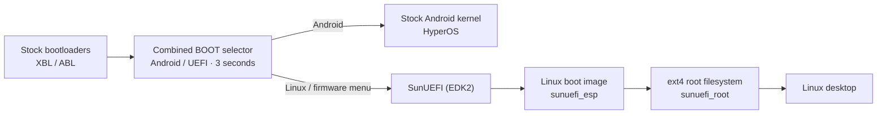

# Project SunUEFI

[简体中文](README.md)

SunUEFI lets the Xiaomi Pad 8 Pro (`piano`) boot Linux from internal storage without replacing the stock Android system. It adapts EDK2 UEFI firmware and mainline-based Linux to the Snapdragon 8 Elite (SM8750) platform. At startup you can choose between HyperOS and UEFI; Android data and the stock Recovery stay in place. Linux is available now. Windows on Arm does not boot yet, and support for the [UniXNU](https://github.com/UniXNU/UniXNU) boot chain is planned.

[Install Linux](#install-linux) · [Hardware support](#hardware-support) · [Known issues](docs/user/known-issues.md) · [Recovery](docs/user/recovery.md)

## What SunUEFI provides

- An Android boot assistant, opened through KernelSU or SukiSU, that manages installation, partitions, and boot choices without a computer. The desktop images come with animations enabled, Chromium, and automatic login.
- A combined BOOT image that keeps the stock Android kernel and adds a boot selector and UEFI. The same UEFI image serves combined BOOT, the installer, and [temporary boot](docs/user/temporary-boot.md).
- Linux hardware support through standard kernel drivers and device trees. The images use normal distro update tools to install signed kernel, firmware, and device packages.
- A USB Fastboot service while UEFI is running, so a computer can export logs and screenshots, access the designated partitions, or request a boot without using the tablet screen.
- Persistent UEFI variables in files on the stock `persist` partition. No SPI flash is required.

## What happens at startup

The selector gives you about three seconds to choose Android or UEFI. Move with the volume buttons and press Power briefly to select. If you do nothing, the tablet follows the preference saved in the boot assistant. The initial preference is Android. Choosing a different entry at startup affects only that boot.



From Linux, run `piano-next-boot android --reboot` to return to Android. In Android, `reboot recovery` starts the stock Recovery without changing the saved boot preference. After a HyperOS update, open the boot assistant and choose **维护 → 重新安装引导** (Maintenance → Reinstall bootloader). See [how combined BOOT works](docs/devel/boot/combined-boot.md).

| Connection | When it appears | What it does |
| --- | --- | --- |
| Stock bootloader Fastboot | With the boot key combination or `adb reboot bootloader` | The stock Xiaomi Fastboot, used for flashing |
| [UEFI Fastboot](docs/user/fastboot.md) (`SunUEFI-piano`) | While SunUEFI is running | Logs, screenshots, reading partitions, flashing the independent boot and system partitions, and boot requests |
| Linux USB network / SSH | After Linux starts | Linux remote login |

## Screenshots

| | |
| --- | --- |
| <br>Boot selector | <br>UEFI splash |
| <br>Debian GNOME and camera preview | <br>Android boot assistant |

| Minecraft · Vulkan / Turnip | Minecraft · OpenGL / Freedreno |
| --- | --- |
|  |  |

Both screenshots show unmodded Minecraft 26.3 on the tablet's 3K screen. The displayed frame rates are snapshots from different scenes.

| Steam gaming mode | Genshin Impact |
| --- | --- |
|  |  |
| Genshin Impact launcher | Magical Girl Witch Trials |
|  |  |

## Hardware support

Combined BOOT supports both Chinese and international Xiaomi Pad 8 Pro units. The table describes Linux unless otherwise noted. See [project status](docs/status.md) and [known issues](docs/user/known-issues.md) for details.

| Hardware | What works |
| --- | --- |
| Display | 3200×2136, 120 Hz by default, selectable refresh rates, 10-bit output, and HDR playback. No 12-bit output or FRC. |
| Adreno GPU | Vulkan through Turnip and OpenGL through Freedreno. Continuous resizing can be slower in some GTK apps. |
| Touchscreen | Taps, drags, long presses, and gestures at roughly 144 Hz. |
| Official keyboard and trackpad | Includes the keyboard backlight. Use Right Ctrl plus the number row for F1–F12; see [keyboard shortcuts](docs/user/keyboard.md). |
| Focus Pen Pro | Position and pressure at 120 Hz. GNOME recognizes it in its tablet settings. [Some gestures and palm rejection features](docs/user/known-issues.md#触控笔) are limited. |
| Audio | Four speakers and native mono microphone capture. |
| Wi-Fi and Bluetooth | Bluetooth uses the device's factory address. |
| Cameras | Front and rear preview and recording, auto exposure and focus, and a physical camera indicator. See [known issues](docs/user/known-issues.md) for flash use. |
| Sensors and Night Light | Rotation, light, proximity, compass, and automatic brightness. Night Light uses a generic sRGB profile. |
| Power | Dual batteries, USB PD and Xiaomi fast charging, charging through a dock, USB OTG, lid detection, suspend, and wake. GNOME offers power saver, balanced, and performance modes. No hibernation. |
| USB and external storage | Type-C role and orientation switching, 5 Gbit/s USB networking, and read/write access to FAT32, exFAT, and NTFS drives and cards. |
| Video codecs | Iris and V4L2 hardware acceleration with the supplied FFmpeg package. |
| SteamOS | Gaming and desktop modes, with Proton and FEX for supported games. Some games need their own launch options. |
| Fingerprint reader | Linux enrollment and authentication through libfprint and fprintd, separate from Android enrollment. |
| Firmware menu | Use the volume and power buttons on Piano. The fourth-generation Y700 supports single-finger taps and swipes in UEFI. |

## Install Linux

You need a Xiaomi Pad 8 Pro with an unlocked bootloader and KernelSU or SukiSU. Back up important files before setting aside storage for Linux. Reinstalling an image overwrites the existing independent system, not Android data.

1. Open a versioned [GitHub Release](https://github.com/slwyts/Project-SunUEFI/releases) and download three ZIPs from the same release: `SunUEFI-Module.zip` (boot assistant), `SunUEFI-ESP.zip` (shared boot image for the EFI System Partition), and `SunUEFI-Root-<edition>.zip` (system image). Extract the outer ZIP files.
2. Install the extracted `SunUEFI-Piano-<version>.zip` in your module manager. Press Volume Up when prompted to install the bootloader, reboot, then tap **打开 WebUI** (Open WebUI) on the module card.
3. In **存储** (Storage), tap **创建独立分区** (Create independent partitions), choose the size, and reboot. Skip this step if `sunuefi_esp` and `sunuefi_root` already exist.
4. In **存储** (Storage), select `esp.sparse.img` and `root-<edition>.sparse.img`, then tap **安装所选镜像** (Install selected images).
5. In **启动** (Boot), choose **UEFI** and **Linux**, then tap **保存并重启** (Save and reboot).

Choose Debian GNOME, Debian KDE, Nyarch GNOME (Arch Linux ARM + GNOME), SteamOS, or the Denial touch desktop on Debian or Arch Linux ARM. The first boot takes longer because Linux expands the root filesystem to fill its partition. The images log in automatically as `piano`; the password for the lock screen and `sudo` is `piano123456`.

For a development build, open a successful run of [Build products in GitHub Actions](https://github.com/slwyts/Project-SunUEFI/actions/workflows/build-products.yml). Download and extract the artifact named `downloads.json`, then use the links in the extracted file to download from Cloudflare R2. Only the three most recent development image builds are kept. Versioned releases stay available.

[Installation guide](docs/user/install-from-artifact.md) · [Flash from a computer](docs/user/install-from-computer.md) · [Try UEFI without flashing](docs/user/temporary-boot.md) · [SteamOS guide](docs/user/steamos.md)

## Update Linux

SunUEFI's signed package repositories deliver kernel, device tree, firmware, and other device updates without reflashing the system image.

| System | Repository | Update command |
| --- | --- | --- |
| Debian GNOME, KDE, and Denial | APT: `https://sunuefi-repo.okassets.uk/apt`, `sid main`, `arm64` | `sudo apt update && sudo apt upgrade` |
| Nyarch and Arch Denial | pacman: `[sunuefi]` | `sudo pacman -Syu` |
| SteamOS | pacman: `[sunuefi-steamos]` before `[sunuefi]` | `sudo pacman -Syu` |

The pacman server URL for both repositories is `https://sunuefi-repo.okassets.uk/pacman/$repo/os/$arch`. The SteamOS repository provides overrides built for Valve's user space; common packages come from `sunuefi`. The repositories keep builds from the last five package releases. If an old link stops working, refresh the package lists before updating.

See [repository setup and updates](docs/user/getting-started.md#软件源与更新) for manual configuration.

## Build from source

You need a Linux host (x86_64 or ARM64) and Docker. Complete system images require an ARM64 builder and a privileged container.

```sh
./build.sh sources   # Fetch pinned upstream sources
./build.sh check     # Run host checks
./build.sh uefi      # Build artifacts/product/PianoUEFI-product.img
```

See the [build guide](docs/devel/building.md) for container use, distro builds, and output paths.

```text
uefi/       EDK2 platform, firmware core, and boot code
linux/      Kernel configs, device trees, board support, and distro packages
android/    Android boot assistant and Android-side tools
patches/    Patches for Linux, firmware, Gamescope, and other upstream projects
tools/      Build, packaging, and check scripts, reached through ./build.sh
config/     Kernel, firmware, and distro release configuration
upstream/   Pinned upstream submodules
vendor/     Board-specific inputs
tests/      Host-side tests
docs/       Documentation
```

## Credits and contributing

The firmware is based on [EDK2](https://github.com/tianocore/edk2) and [Mu-Silicium](https://github.com/Project-Silicium/Mu-Silicium), with a boot menu from [simple-init](https://github.com/BigfootACA/simple-init). The kernel and Debian base build on [linux-piano](https://github.com/blu-sharky/linux-piano) and [debian-piano](https://github.com/blu-sharky/debian-piano). Device firmware comes from the official OTA, and graphics user space uses [Mesa](https://mesa3d.org/). See [upstream projects](docs/devel/upstreams.md) and [third-party sources](THIRD_PARTY.md).

If you reuse code, data, photos, or findings from this project, please credit [Project SunUEFI](https://github.com/slwyts/Project-SunUEFI) and retain the original copyright and license notices when redistributing code. Patches for new devices and firmware support are welcome.

[Contribution guide](CONTRIBUTING.md) · [AI collaboration guidelines](AGENTS.md) · [License](LICENSE.md) · [Developer docs](docs/README.md) · [QQ group 1135414849](https://qm.qq.com/q/C1RkQC2yYw)
